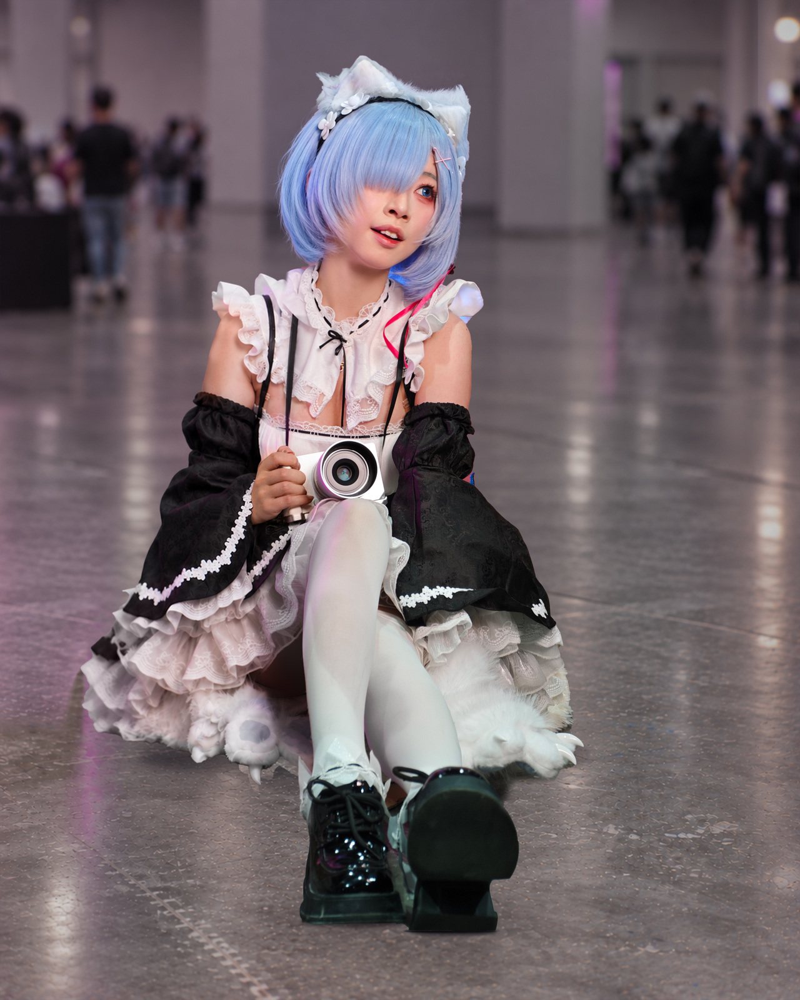
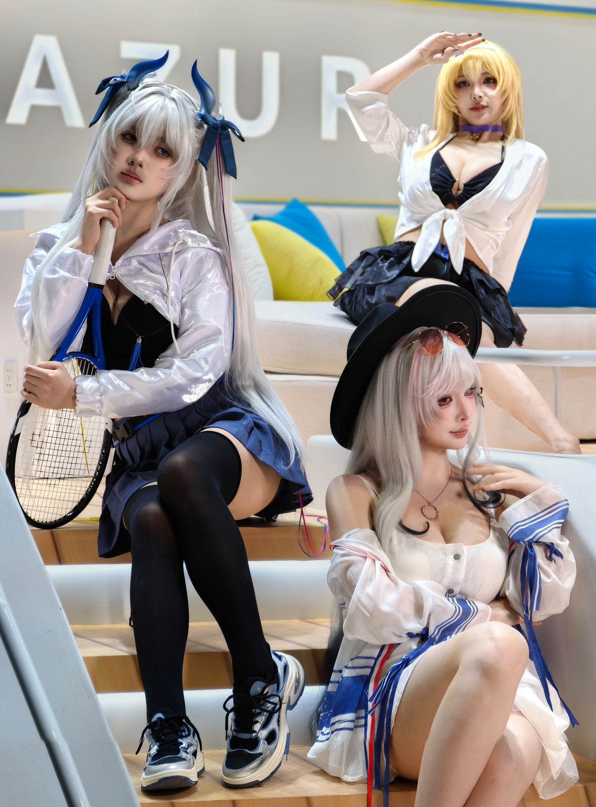
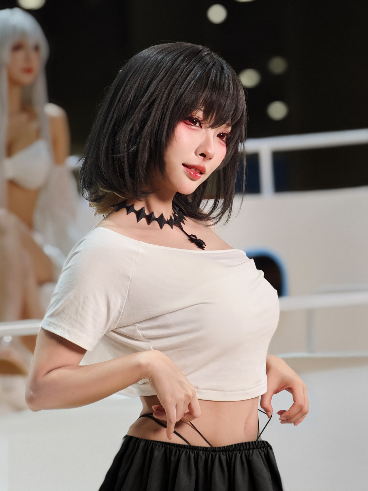
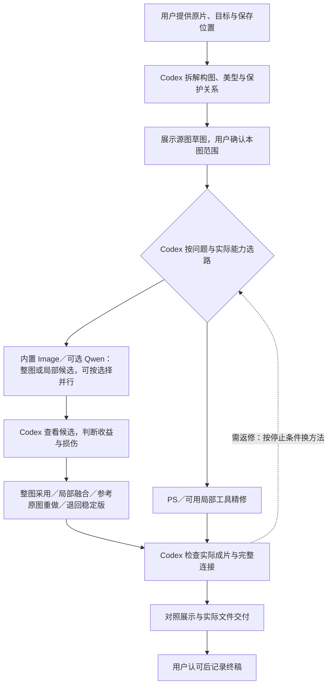
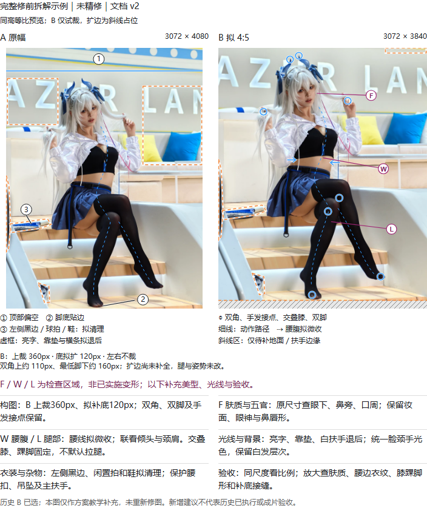
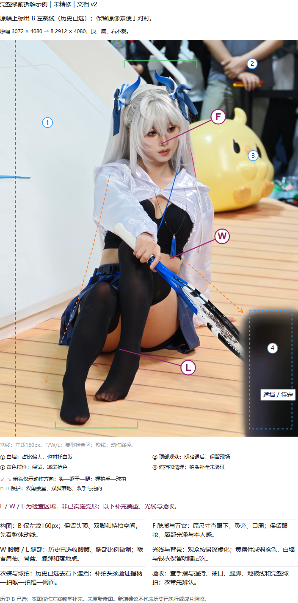

# natural-shaping · Cos 照片 P图与人像精修 Skill

**人像精修与 Cosplay 修图 Skill for Codex · Portrait & cosplay photo retouching**

用 AI 辅助 Cos 照片 P图、漫展修图与人像精修的可移植技能：先拆解构图、展示原片标注草图，确认后再精修肤质、五官、身形、光线与背景。保留本人感、角色妆造、关节和道具结构，并主动检查修后瑕疵。

A reusable **photo retouching agent skill** for Codex, focused on **portrait retouching** and **cosplay photo editing**. The workflow is defined in [`natural-shaping/SKILL.md`](natural-shaping/SKILL.md): source-based composition sketches, identity-preserving refinement and visual quality checks, with **Photoshop ExtendScript (JSX)** helpers. Codex chooses among the tools available in your environment: built-in image generation/editing can run the editing route without Qwen; Qwen is an optional backend, and Photoshop enables precise local work and layered delivery when available.

[实战教程与效果拆解](https://yeliannaa.github.io/natural-shaping/) · [安装与使用](#安装与使用) · [两种修图档位](#两种修图档位) · [公开审美参考库](#公开审美参考库) · [调用链与分工](#调用链与分工) · [缺少工具时如何继续](#缺少工具时如何继续) · [常见修图问题](#常见修图问题faq) · [按问题看案例](#按问题看案例) · [构图草图](#构图草图composition-sketches) · [12 张示例与版本状态](natural-shaping/assets/examples/README.md) · [完整流程](natural-shaping/SKILL.md)

## 代表效果与细节拆解

三组真实案例展示不同问题：**蕾姆的遮挡与衣装连接、群像的逐人补光、宫本樱的衣带受力与手部补全**。点击进入原片／终稿对照、构图标注和局部细节教学。

<table>
<tr><th>蕾姆 · 遮挡、彩光与袖口</th><th>群像 · 三人构图与气色</th><th>宫本樱 · 手部与双侧衣带</th></tr>
<tr>
<td><a href="https://yeliannaa.github.io/natural-shaping/rem.html"></a></td>
<td><a href="https://yeliannaa.github.io/natural-shaping/group.html"></a></td>
<td><a href="https://yeliannaa.github.io/natural-shaping/sakura.html"></a></td>
</tr>
<tr>
<td>看坐姿与相机形成的视觉路径，怎样检查发缘、黑色带子及手背—手腕—袖口的连续性。<a href="https://yeliannaa.github.io/natural-shaping/rem.html">详细拆解</a></td>
<td>看三张脸的层次、左侧人物眼周与唇色、前后人物关系，以及合影边缘的取舍。<a href="https://yeliannaa.github.io/natural-shaping/group.html">详细拆解</a></td>
<td>看双侧衣带的起点、数量、松紧与握点；腰腹修改还要联看肚脐、裤腰和手指。<a href="https://yeliannaa.github.io/natural-shaping/sakura.html">详细拆解</a></td>
</tr>
</table>

也可以直接在 GitHub 阅读[蕾姆](docs/rem.md)、[群像](docs/group.md)、[宫本樱](docs/sakura.md)的图文分析；[教程站源码与维护说明](docs/README.md)随仓库提供。

每页按**位置 → 观看影响 → 处理方法 → 检查重点**拆解，附整图对照与局部特写。原尺寸 JPG 见[成片示例目录](natural-shaping/assets/examples/README.md)。

## 高P精修：整图设计与局部细节

瑶的两张场照采用 **内置 Image＋PS**：先用整图设计统筹人物、发衣与场景光线，再细化完整脸部的比例、表情和妆面，最后由 PS 完成融合、材质与尺寸交付。

[](https://yeliannaa.github.io/natural-shaping/highp.html#portrait-map)

[](https://yeliannaa.github.io/natural-shaping/highp.html#wide-map)

[打开高P完整拆解与局部放大](https://yeliannaa.github.io/natural-shaping/highp.html) · [GitHub 图文版](docs/highp.md) · [详细控制项、提示词与实测参数](natural-shaping/references/highp-controls.md)

图中用编号、辅助线和区域说明构图动线、脸部轮廓、妆面联动、全局受光与握持保护。打开案例页可放大查看脸颈、珠光衣料、前景手和透明饰件。

## 三步开始

1. 按[安装与使用](#安装与使用)复制完整技能目录，并确认当前应用有实际图像编辑工具。
2. 提供照片与输出目录，调用 `$natural-shaping`；先查看基于原片的构图、美型与保护方案，再确认范围。
3. 检查实际成片及局部对照，认可后保存终稿。第一次使用可跟着[完整实战教程](https://yeliannaa.github.io/natural-shaping/first-photo.html)操作。

Qwen 是可选后端；内置图像编辑可独立承担生成路线。精确 PS 编辑和 PSD 交付需要实际 Photoshop 连接。详见[调用链](#调用链与分工)与[缺少工具时如何继续](#缺少工具时如何继续)。

## 能做什么

| 方向 | 工作内容 |
|---|---|
| 构图与沟通 | 分析留白、动作路径、画边与遮挡；给出可比较的原片草图，确认后执行 |
| 人像精修 | 分别判断肤质、五官、肩颈、腰腹及腿脚比例，保护身份和妆造 |
| 光线与背景 | 肤色与彩光衔接、按景深弱化路人、处理具体干扰并保留现场感 |
| 假发与杂毛 | 按复杂度选择原生修复或局部生成，清理抢眼乱丝，保护主发、绒毛及饰件并保留自然碎发 |
| 道具与验收 | 联看手、衣带、球拍等完整连接；查新增损伤、原尺寸细节与实际交付文件 |

包内包含修图流程、参考图和辅助脚本；图像编辑工具按当前环境接入。

## 两种修图档位

| 档位 | 目标与范围 | 执行依据 |
|---|---|---|
| 自然美型（默认） | 明显改善适用的肤质、五官、比例与光色，保持本人感、角色妆造和摄影质感 | 按本图收益选择原生精修、生成或混合处理，不套固定脸型或统一拉腿幅度 |
| 高P精修（明确选择） | 可以更大胆地设计整图人物、脸型五官、联动表情、妆面、发衣、比例、光线和背景 | 先展示基于原片的[高P确认计划](natural-shaping/references/highp-retouch.md)，确认范围后执行；仍检查识别特征和结构 |

内置 Image 与可选 Qwen 可分别出候选，供比较和选用。根据效果整图采用、局部融合或参考重做，再由 PS 处理尺寸和细节。

## 公开审美参考库

[阅读参考库](natural-shaping/references/aesthetic-reference/README.md) · [按标签查9条索引](natural-shaping/references/aesthetic-reference/index.json)

按**问题 → 目标 → 参考 → 做法**整理自然轻修、妆造神情、腕袖连接、衣带受力、坐姿透视、群像光线、高P设计和假发清理。

每次按问题挑选1–3条参考，结合当前照片制定方案。个人偏好与训练资料保存在本地，可按[私人档案说明](natural-shaping/references/personal-data.md)配置。

## 安装与使用

下载或克隆本仓库，将整个 [`natural-shaping/`](natural-shaping/) 文件夹放入目标应用支持的技能目录，保持内部目录结构；不要只复制 `SKILL.md`。不需要另外安装原作者的其他修图 skill。首次使用先阅读[移植说明](natural-shaping/references/portability.md)，确认应用已识别技能并检查实际工具入口；选择 PS／随包脚本路线时再用合成小图测试会用到的功能。

也可以通过 [Vercel Skills CLI](https://github.com/vercel-labs/skills) 安装。以下固定版本命令需要 Node.js 22.20.0 或更高版本；先列举仓库中的技能：

```sh
npx skills@1.7.1 add yeliannaa/natural-shaping --list
```

在目标项目目录中，为 Codex 复制安装该技能：

```sh
npx skills@1.7.1 add yeliannaa/natural-shaping --skill natural-shaping --agent codex --copy --yes
```

也可通过 [skills.sh 技能条目](https://www.skills.sh/yeliannaa/natural-shaping/natural-shaping)查看安装入口。

在支持 `$` 调用的 Codex 环境中，可提供照片或文件夹并这样请求：

```text
$natural-shaping 请先拆解这张 Cos 照的构图，展示基于原片的方案草图。
等我确认后，再精修肤质、五官、身形、背景和光线，并保存到我指定的目录。
```

每张新图或完整重修，应先展示草图并等待确认。同一方案内的局部返修沿用已有确认。源图保持只读，照片、PSD 和预览保存在本次任务目录，不写入技能安装目录。

**Quick start:** Copy the complete `natural-shaping/` folder into the skill location supported by your application. Provide a photo and output directory, invoke the skill, review the composition sketch, then confirm the editing scope. See [portability and dependencies](natural-shaping/references/portability.md) before using the scripts.

## 调用链与分工

**Codex 负责主导整条流程**：分析照片、展示构图与美型方案、准备工具输入、调用当前可用工具、查看实际结果并验收。Qwen 与内置图像编辑是可选生成路线，PS／局部编辑工具用于精确调整和按需融合；无需每张照片都调用全部工具。



新图先看草图并确认；同一方案内的局部返修直接继续。完整流程见 [SKILL.md](natural-shaping/SKILL.md)。

| 环节 | 谁负责 | 分工与采用条件 |
|---|---|---|
| 构图与整体美型判断 | Codex 主导，用户确认方向 | 联看脸型五官、假发颈肩、胸腰髋和腿脚，给出完整调整方向与保护点 |
| 精确肤质、光色与比例调整 | Codex 调用 PS／当前可用的局部编辑工具 | 分开处理纹理、明暗、颜色和几何；保留角色妆造、关节、衣装与握点，按本图实际收益决定强度 |
| 可选身体定位与原生液化 | Codex 复核关键点，再调用 PS 几何工具 | 辅助定位身体关键点，再按本图制定几何调整和保护范围 |
| 补光、美型探索、复杂修复与补全候选 | Codex 调用内置图像编辑／可选 Qwen，按选择比较两路 | 准备原图与参考，调用工具生成候选，再检查人物、衣装与结构 |
| 采用与收尾 | Codex 判断，局部工具按能力执行 | 整图通过才整图采用；局部有益且能可靠对齐时融合；只有方向有价值时参考原图重做；不合格则退回稳定版 |
| 成片验收与交付 | Codex 负责检查和保存，用户确认终稿 | 检查整体效果、妆造、细节与连接，展示对照并保存指定格式 |

详细判断见 [美型分工](natural-shaping/references/portrait-beauty.md#美型的判断与执行分工)、[引擎与候选采用](natural-shaping/references/cos-retouch-engines.md#codex-主导与可选生成后端)及 [生成验收](natural-shaping/references/quality-review.md#生成候选的采用检查)。

选择双路时，本地 Qwen 与云端 Image 可并行生成。局部候选按裁剪坐标融合，并检查妆面、主发束和道具连接。

## 缺少工具时如何继续

Codex 根据当前环境选择执行路线：

| 当前环境／缺少的能力 | 由谁接替执行 | 可以继续做什么与交付边界 |
|---|---|---|
| 没有 Qwen，或 Qwen 不可调用／资源不足 | Codex 调用内置图像编辑，有 PS 时继续精修 | 继续生成候选、检查效果，有 PS 时完成局部收尾 |
| 没有内置图像编辑，但 Qwen 已接入可用 | Codex 调用已获授权的 Qwen；有局部工具时按需收尾 | 生成候选，并检查妆造、结构与细节 |
| 没有 PS，但有内置编辑或 Qwen | Codex 调用现有生成／其他可用栅格编辑工具 | 生成并交付 JPG／PNG，按现有编辑工具完成局部处理 |
| Qwen 与 PS 都没有，但内置编辑可用 | Codex 直接调用内置图像编辑 | 可以独立完成候选编辑、复核与栅格交付；不需要另装原作者的个人 skill |
| 没有任何生成后端，但 PS／局部编辑工具可用 | Codex 使用已授权的原生编辑路线 | 继续肤质、光色、可控几何与真实纹理修补；缺失内容无法可靠完成时保留稳定版并说明限制 |
| 没有身体识别模型，或关键点不可靠 | Codex 人工看图定位 | 依据照片人工定位关节、轮廓与保护区 |
| 液化模块不可用 | Codex 使用其他已接入的 PS 几何／局部方法 | 使用已接入的 PS 几何工具；需要重建时调用生成工具 |
| 没有任何实际图像编辑能力 | Codex 只进行看图诊断与方案说明 | 提供看图诊断与修图方案 |
| 用户明确只用某个后端，而它不可用 | Codex 核实状态，说明缺口并确认可接受替代 | 继续照片分析，等待指定后端恢复或用户选择替代 |

工具接入和首次环境检查见 [移植说明](natural-shaping/references/portability.md)。用户指定后端时按其选择执行。

## 构图草图｜Composition sketches

以下在**精修前原片**上标注构图、脸身美型、光线背景与衣装道具。F/W/L 分别定位面部、腰部和腿部，配合箭头说明调整方向与保护关系。

### Cos 交叠腿坐姿：裁顶补底与腰线协调｜狩司司 114

比较 A/B 裁顶补底；同时拆解肤质五官、肩颈腰线、光色与杂物清理，保留交叠膝和脚形。

[](natural-shaping/references/composition-and-key-elements.md#狩司司-114-号用-ab-解释裁顶与少量补底)

### Cos 坐姿精修：收腰、腿部比例与球拍保护｜狩司司 110

联看白墙、观众与持拍动线；说明收腰腹、腿部比例、脸颈手光色，以及球拍结构验收。

[](natural-shaping/references/composition-and-key-elements.md#狩司司-110-号动线遮挡与道具补全边界)

点击图片阅读[完整拆解与取舍](natural-shaping/references/composition-and-key-elements.md#示例草图的制作与展示)。

## 常见修图问题｜FAQ

### 自然磨皮怎样保留皮肤纹理？｜Skin retouching

先区分局部瑕疵、噪点、真实肌理和角色妆面，再分别处理肤质、明暗与肤色。自然磨皮（skin smoothing）的目标是皮肤细腻且可信，眼妆、唇部纹理与本人特征仍清楚；放大复查涂抹感、灰边及脸颈色差。方法见[肤质与五官精修](natural-shaping/references/portrait-beauty.md)。

### 可以瘦脸、收腰／瘦腰和拉腿吗？｜Body reshaping

支持按照片协调脸型、腰腹和腿部比例。先区分透视、姿态与光影，再做局部几何调整；联看胸腰髋、膝踝、脚形及背景直线，保护衣纹、饰件和关节。可选身体定位辅助确定关键点，PS 几何操作按本图制定。见[身形与姿态](natural-shaping/references/shape-and-pose.md)和[液化 API 与支持边界](natural-shaping/references/ps-runtime.md#optional-native-liquify-in-107)。

### Cos 场照怎样做路人虚化、肤色统一与调色？｜Background blur & color grading

按景深、明暗和色彩弱化路人，让人物更突出并保留现场感。背景虚化（background blur）要检查发缘与道具边界；调色（color grading）联看脸、颈、手、假发和服装，避免肤色断层或彩光来源不合理。具体遮挡是否清理另行判断。见[光色与边缘](natural-shaping/references/tone-and-edges.md)。

### 手、衣带、道具或画边缺失，可以局部补全吗？

优先使用真实原像素与相容参考，缺失内容明确标为推断。按确认范围试修后，检查整条连接、握持、透视、材质和接缝；结构仍不可靠时保留稳定版本并说明问题。见[结构复核与局部生成](natural-shaping/references/structure-review-and-generation.md)。

### 假发杂毛、飞丝和交叉毛网怎样清理？

少量孤立丝可原生修复，密集或跨皮肤／绒毛／道具的乱丝可尽早生成局部候选，再受控融合。输入留足头型与材质上下文，采用范围限于需要清理的发丝及修补足迹；检查完整发丝两端与原尺寸接缝，保留自然碎发和蓬松感。达到本图目标就收尾，不默认清成光滑硬壳。见[发丝清理流程](natural-shaping/references/tone-and-edges.md#杂毛与飞丝清理)。

### 需要哪些工具？能直接一键修图吗？

由 Codex 主导分析、调用工具和检查。内置图像编辑可独立完成生成路线，Qwen 可选；精确 PS 操作和分层 PSD 需要 Photoshop 连接。见[迁移与能力检查](natural-shaping/references/portability.md)。

### 同组照片可以批量修图吗？

先完成代表片，再复用该组的基础色调与处理结构。每张照片单独调整构图、曝光、蒙版和几何范围，并逐张检查。见[同组处理方法与边界](natural-shaping/references/pixcake-cos-workflow.md)。

## 按问题看案例

按当前问题直接找到相应案例与处理方法：

| 想解决的问题 | 处理方式与案例入口 | 已知结果 |
|---|---|---|
| 磨皮之后，五官、身形和整体质感仍不够精致 | [dora 与蕾姆成片示例](natural-shaping/assets/examples/README.md) | dora v7、蕾姆 v21 |
| 彩光调色后出现粉边、颗粒和假发切面 | [蕾姆：按光源和材料校正彩光、接回发缘](natural-shaping/references/personal-cases.md#ns04蕾姆当前效果与历史粉光问题) | 当前示例：蕾姆 v21 |
| 收腰、拉腿和球拍补全怎样保持坐姿可信 | [狩司司：整体比例、握持与球拍透视一起复核](natural-shaping/references/personal-cases.md#ns10狩司司三张已保存示例与球拍返修) | 110 v4 已保存版 |
| 手、衣带与衣缘补完仍不自然 | [宫本樱：多视角定位，再锁定结构做材质收尾](natural-shaping/references/personal-cases.md#ns09宫本樱-v8-结构认可--v9-材质收尾与指定目录交付2026-10-06) | v9 材质收尾版 |
| 鼻旁阴影显硬，是否需要直接瘦鼻 | [鼻旁局部：先柔化光影，再判断鼻形](natural-shaping/references/personal-cases.md#ns03鼻旁先柔光不默认改变鼻形) | 鼻旁柔光局部案例 |
| 群像补鞋不可靠，人物气色又不一致 | [群像：补全边界与逐人气色检查](natural-shaping/references/personal-cases.md#ns12群像111补鞋撤回气色漏检与派生层2026-10-07) | 当前示例：群像 111 v5；下沿已补全 |

## 工具与能力边界

| 工具 | 用途 |
|---|---|
| 文件读取与图像查看 | 查看原片、准备草图、检查成片 |
| 内置 Image | 整图设计、局部生成与修复候选 |
| Qwen（可选） | 本地候选生成，可与云端 Image 并行 |
| Photoshop＋ExtendScript 连接 | 精确肤质、光色、几何与蒙版调整，预览、导出和分层 PSD |
| PowerShell／Python 3.11+（按需） | PNG 检查、无损压缩及网格辅助脚本 |
| MediaPipe（可选） | 身体关键点和分割参考，供执行者复核定位 |

PS 液化模块支持已接入的 `faceWidth` 与内嵌 v4 网格，接口说明见 [PS runtime](natural-shaping/references/ps-runtime.md#optional-native-liquify-in-107)。自动主体蒙版见[蒙版工具](natural-shaping/references/mask-tools.md)。

## 示例、资料与校验

[成片示例目录](natural-shaping/assets/examples/README.md)包含蕾姆、dora、宫本樱、群像、神里、知更鸟、昔涟、三张狩司司及两张瑶高P，共 12 张指定版本 JPG；局部返修过程见[cases 索引](natural-shaping/references/cases/README.md)。

在仓库根目录运行：

```sh
python natural-shaping/scripts/validate_portable.py
```

校验脚本检查文件清单、SHA256 与本地引用；文件清单见 `natural-shaping/package-manifest.json`。复杂局部合成的实际文件、裁框与复核绑定见[交付检查](natural-shaping/references/delivery-contract.md)。

维护时运行 `python -B -m unittest discover -s tests -v` 检查PNG报告安全、透明度拒绝、训练映射和交付绑定；交付检查测试需要Pillow，PNG行为测试还需PowerShell。GitHub的PR与main提交会自动执行包、展示资料和合成回归检查；这些检查与真实照片目视验收分开。

资料按问题读取，外部链接保留出处，不会每次重新访问全部网页或视频。教程观察与向 PS 迁移的判断分别记录，详见[像素蛋糕方法参考](natural-shaping/references/pixcake-cos-workflow.md)。
