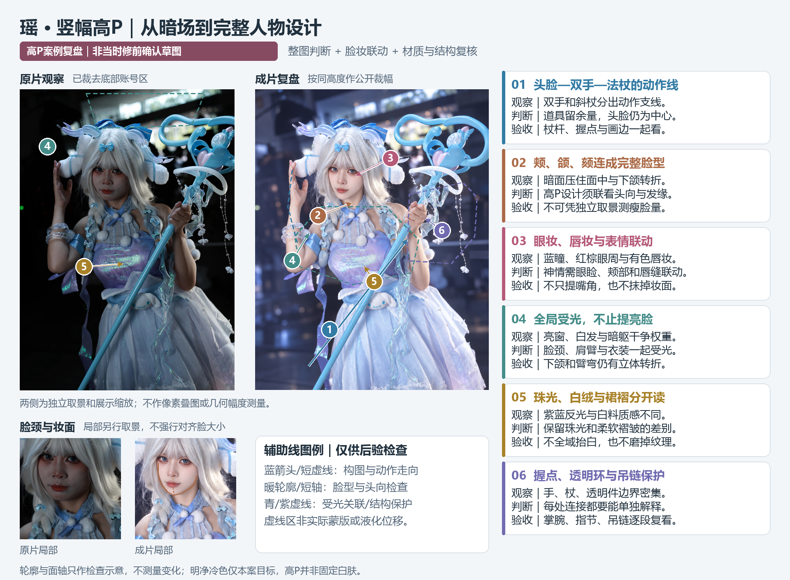
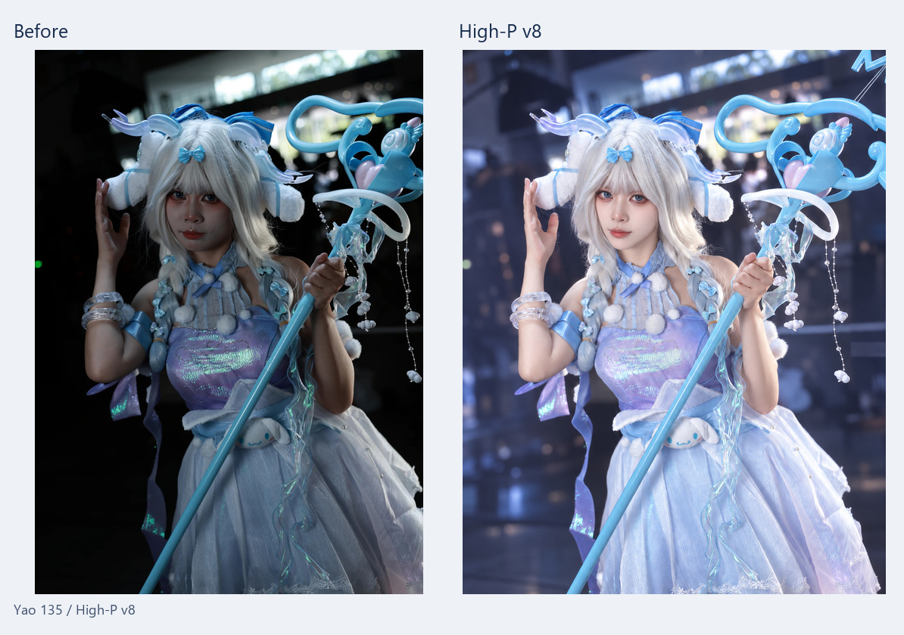
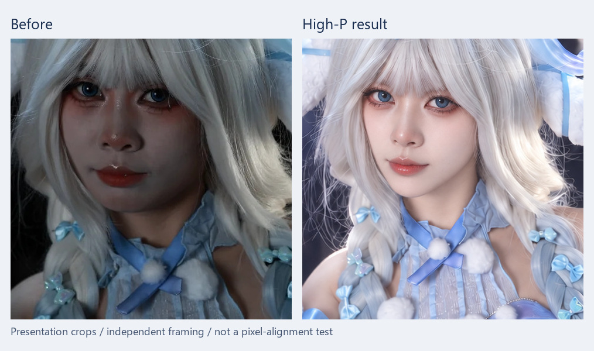
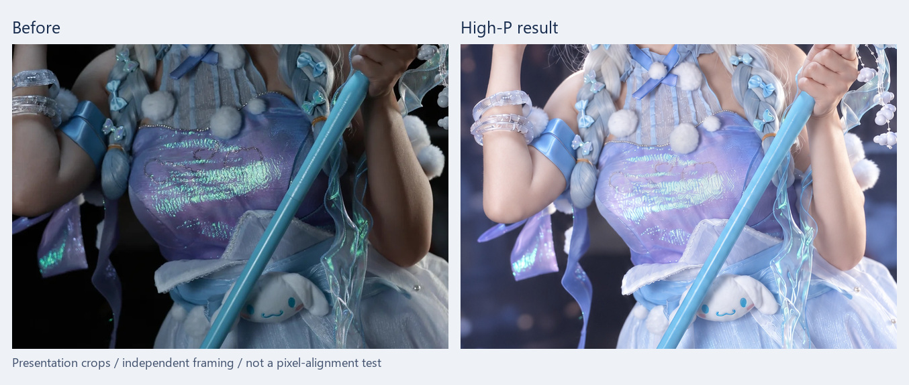
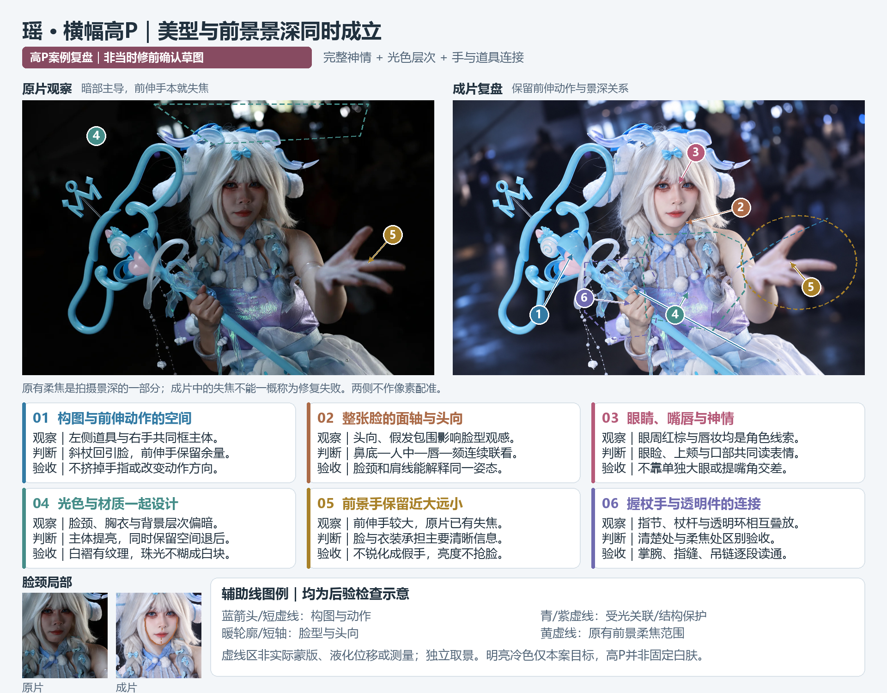
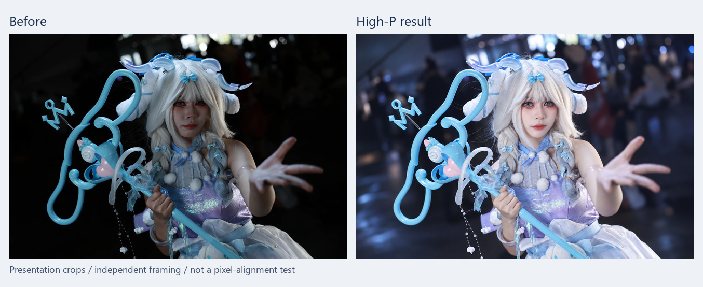
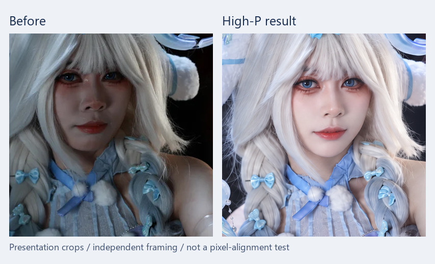
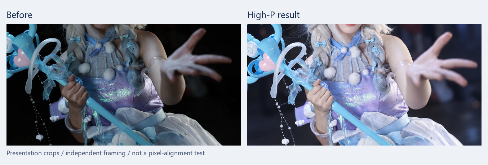

# 高P精修：瑶的全局光线、脸妆与景深设计

两张暗场Cos照的完整设计：竖幅侧重脸颈与完整造型，横幅保留前伸手的近大远小和失焦。高P力度由本图目标决定，人物美型、衣装、光色与背景一起判断。

[交互案例页：可点击放大](https://yeliannaa.github.io/natural-shaping/highp.html) · [高P详细调参](../natural-shaping/references/highp-controls.md) · [高P工作流](../natural-shaping/references/highp-retouch.md)

这是已有认可成片的教学展示，本轮没有重新修图。各组按实际内容独立取景、等比缩放，不是像素配准或改动幅度测量。竖幅原片底部含账号区已裁去，修后同步裁到相同高度；不公开原片原文件与EXIF、XMP。

## 竖幅：通透感来自整张画面的关系

编号、辅助线与检查区按图例对应分析卡片，展示原片问题、成片观察和保护关系。这是**成片后的教学复盘，非当时修前确认草图**；框线不代表实际蒙版、确定修改幅度或新图的确认方案。

源图1440×2160，成片1569×2160；这里分别取1440×2020与1569×2020，再等比生成网页预览。两侧画幅宽度不同，修后较宽的背景与道具余量属于取景变化。

原片亮窗和白发较亮，脸、手臂、衣料落在暗部。成片让脸颈、肩臂、衣料与裙面形成连续光线，背景保留冷色空间和散景；人物不再只靠胸前反光被看见。验收时看鼻侧、下颌、臂弯是否仍有体积，以及白发、白裙有没有因提亮失去材质。

### 脸颈、妆面与表情联动

成片脸部轮廓、肤色与五官观感有明显设计，蓝色美瞳、眼线、下睫毛和唇部光泽仍是角色妆造的一部分。面部明亮不应连眼妆和唇色一起抹掉；去掉暗红也不等于把皮肤、嘴唇变成同一种颜色。

表情需联看双眼状态、颊部转折、鼻唇沟、嘴角、下巴和颈肩，不能只调整嘴角。这里独立裁取两侧局部，不据展示脸大小推算瘦脸或大眼百分比。

### 衣装、手臂与光线

紫蓝珠光、白绒球、半透明饰件和皮肤需要不同的亮度与边缘。适屏看身体到裙面的光线，放大看反光纹理、腕饰、握点和透明环。道具、吊链、双手必须继续能解释各自连接，不能因全图更亮就跳过复核。

## 横幅：保留前景手的景深

这张标注图同样属于成片后的教学复盘；前后独立取景，编号定位观察点，辅助线与区域解释动作、面轴、景深及保护关系，不能量化瘦脸或表情的修改幅度。

源图1440×960，成片2160×1440，均为3:2横幅。前伸手近大远小且失焦，脸、握杖手和衣装承担主要信息。高P后提高主体可见度，保留前伸动作、前景失焦和背景退后的层次；不把所有内容修成同样清楚。

### 脸、假发与颈部一起看

眼周妆面、唇缘、鼻部体积与肤色共同构成人物观感。提亮后再检查假发与颊颌的边界、脸颈色差、颈饰和肩线。同组照片的角度、表情可以不同，关键妆造和特征仍应互相解释。

### 前伸手、握杖手与半透明饰件

前景手保持柔焦，握杖手仍要能解释受力、指节与掌腕连接。透明环、杖杆、吊链与衣料反射分别检查；局部好看后回到全图，确认前景手没有因过亮或错误锐化而抢走脸的视觉中心。

## 本组真实尺寸链与参数边界

这两组成片实测使用内置Image与Photoshop。Image具体型号未暴露；没有把成片观感反推成Qwen的采样步数、CFG或LoRA数值。

| 环节 | 本组实测 | 边界 |
|---|---|---|
| 竖幅整图 | 已整理目标1569×2160 → Image1069×1472 → PS按高2160等比放大 → 1569×2160 | Preserve Details 2.0／deepUpscale，降噪0；工具返回尺寸需实查 |
| 横幅整图 | 已整理目标1536×1024 → Image1536×1024 → PS按宽2160等比放大 → 2160×1440 | 同一PS方法、降噪0；已整理目标不能写成原片原尺寸 |
| 脸部局部 | 准备1024上下文图和640聚焦裁片；实际Image1254×1254 → PS Bicubic缩到640×640，按原裁剪位置贴回 | 未证明两种准备图同次都发送；输入上下文与最终采用范围分开决定 |
| 局部蒙版 | 本组640局部使用Gaussian半径8px柔化 | 仅对应此组蒙版和尺度；新尺寸、发丝、跨材质或硬道具边缘需重新决定 |

扩大输出尺寸不能恢复原片中没有记录到的发丝、蕾丝或珠链细节。蒙版变柔也不等于连接合理。可执行的目标、提示词、参数试调顺序和失败边界见[高P详细调参说明](../natural-shaping/references/highp-controls.md)。

## 验收重点

1. 全局光线、脸妆、衣装和背景是否一起改善；白净、粉润与妆色按本图取舍。
2. 整张头脸和同组照片联看，确认眼睛、表情、脸颈、手腕、握点、饰件与透视。
3. 重开实际导出图，在适屏与100%局部复核融合两端、透明材质和衣料纹理；原有失焦不误当作结构缺失重画。

公开成片为已认可高P母稿135 v4与140 v3，没有把后续发丝局部候选升级为新的全图案例。包内另有[竖幅原尺寸JPG展示副本](../natural-shaping/assets/examples/yao-highp-portrait-final.jpg)与[横幅原尺寸JPG展示副本](../natural-shaping/assets/examples/yao-highp-wide-final.jpg)，均清除私人元信息。JPG是有损展示副本，不是原始细节恢复或训练配对的证明。

[案例首页](https://yeliannaa.github.io/natural-shaping/) · [宫本樱结构精修](sakura.md) · [蕾姆腕袖与光线](rem.md) · [公开素材说明](assets/highp-showcase.json)
